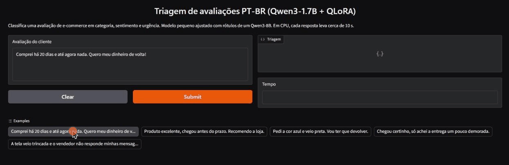
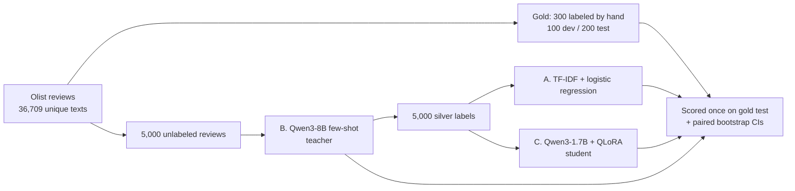

# review-triage-llm

[](https://github.com/SoaresCRF/ai-engineer-portfolio/actions/workflows/review-triage.yml)

**Can a small LLM fine-tuned with QLoRA match a 4.7× larger open LLM at triaging real Brazilian Portuguese customer reviews into structured JSON, at a fraction of the cost?**

Short answer: on two of three fields, yes. A Qwen3-1.7B student trained on 5,000 labels produced by a few-shot Qwen3-8B teacher ties the teacher on `categoria` and `urgencia`, loses 4 accuracy points on `sentimento` (the only statistically clear gap), and runs 3.7× faster in batch. Both LLMs beat a TF-IDF baseline by 7–10 points on `categoria` and `urgencia`; on `sentimento`, neither LLM is clearly better than the baseline. Everything ran on free Kaggle T4s; the whole experiment would cost about $1.30 in rented GPU time.

Model: [SoaresCRF/qwen3-1.7b-review-triage-ptbr-lora](https://huggingface.co/SoaresCRF/qwen3-1.7b-review-triage-ptbr-lora)



## The task

Each review becomes one line of JSON:

```json
{"categoria": "nao_recebido", "sentimento": "negativo", "urgencia": "alta"}
```

| Field | Values |
|---|---|
| `categoria` (main problem) | `atraso_entrega`, `nao_recebido`, `produto_errado_ou_incompleto`, `defeito_ou_qualidade`, `atendimento_vendedor`, `elogio_sem_problema`, `outro` |
| `sentimento` (overall tone) | `positivo`, `neutro`, `negativo` |
| `urgencia` (does the company need to act?) | `alta`, `media`, `baixa` |

Definitions and tie-break rules (several problems: the most severe wins) are in [docs/labeling_guide.md](docs/labeling_guide.md). Keys and labels are Portuguese on purpose: they are the product's data contract.

## Setup

| Approach | What it is | Trained on |
|---|---|---|
| A. Baseline | TF-IDF + logistic regression, one classifier per field | 5,000 silver labels |
| B. Teacher | [Qwen3-8B](https://huggingface.co/Qwen/Qwen3-8B), 4-bit, system prompt + 6 few-shot examples, no thinking | nothing |
| C. Student | [Qwen3-1.7B](https://huggingface.co/Qwen/Qwen3-1.7B), QLoRA, system prompt only | 5,000 silver labels |



- **Data:** the public [Olist Brazilian E-Commerce dataset](https://www.kaggle.com/datasets/olistbr/brazilian-ecommerce): 99,224 reviews, 40,977 with a comment, 36,709 after removing duplicates (median 62 characters). Emails, CPFs and phone numbers are masked by regex; personal names are not, as the source dataset is already public.
- **Sampling:** gold and silver have the same number of reviews per star rating (1–5). In the raw data 48% of reviews are 5 stars, so complaints are over-represented here on purpose: the metrics describe a balanced mix, not production traffic, where accuracy is likely higher because easy praise dominates.
- **Gold:** 300 reviews labeled by hand, blind (text only, no star rating), split 100 dev / 200 test. A second blind pass over 30 random gold reviews matched the first on all three fields for all 30 ([results/self_agreement.json](results/self_agreement.json)); see the caveats under "What did not work". Gold reviews never appear in the silver set or the few-shot examples (checked by tests and by the Kaggle bundle builder).
- **Silver:** 5,000 other reviews labeled by the teacher (100% valid JSON). A and C both learn from them, so the comparison isolates the model, not the data.
- **Discipline:** the prompt was revised once, on dev. The test set was scored once, on 2026-11-13, after every decision was frozen ([results/final.json](results/final.json): quality, latency, throughput and cost of A, B and C in one file).
- All three approaches share one parser (`review_triage.prompts.parse_output`), so valid-JSON rates are comparable.

## Results

Gold test set, n = 200. Accuracy / macro-F1:

| Approach | categoria | sentimento | urgencia | Valid JSON |
|---|---|---|---|---|
| A. TF-IDF baseline | 0.775 / 0.70 | 0.795 / 0.73 | 0.745 / 0.74 | 100% |
| B. Qwen3-8B teacher | **0.870** / **0.78** | **0.840** / **0.77** | 0.820 / 0.81 | 100% |
| C. Qwen3-1.7B student | 0.855 / 0.77 | 0.800 / 0.69 | **0.825** / **0.82** | 100% |

With 200 reviews, one review is 0.5 points. To separate real gaps from noise, a paired bootstrap (2,000 resamples of the test reviews, the same reviews for every approach) gives 95% CIs for each difference in accuracy ([results/bootstrap_test.json](results/bootstrap_test.json), which also has macro-F1):

| Difference in accuracy (points) | categoria | sentimento | urgencia |
|---|---|---|---|
| Teacher − student | +1.5 [−1.5, +4.5] | **+4.0 [+1.0, +7.5]** | −0.5 [−4.0, +3.0] |
| Teacher − baseline | **+9.5 [+4.0, +15.0]** | +4.5 [−1.5, +10.5] | **+7.5 [+2.0, +13.0]** |
| Student − baseline | **+8.0 [+3.0, +13.5]** | +0.5 [−4.5, +5.5] | **+8.0 [+3.0, +13.5]** |

Bold: the CI excludes zero. The student's only real loss is sentiment (macro-F1 −7.6 [−13.4, −1.9]). And on sentiment, a TF-IDF model trained on the same silver labels is statistically as good as either LLM: extra model capacity buys little until `neutro` is better defined and labeled. The student agrees with the teacher on 93–94% of test reviews in each field.

F1 per class on the test set (support in parentheses; confusion matrices are in [results/final.json](results/final.json)):

| Class | A. Baseline | B. Teacher | C. Student |
|---|---|---|---|
| `elogio_sem_problema` (68) | 0.87 | 0.98 | 0.96 |
| `produto_errado_ou_incompleto` (36) | 0.80 | 0.89 | 0.85 |
| `nao_recebido` (29) | 0.86 | 0.92 | 0.90 |
| `defeito_ou_qualidade` (28) | 0.79 | 0.86 | 0.89 |
| `outro` (18) | 0.31 | 0.42 | 0.36 |
| `atraso_entrega` (14) | 0.70 | 0.84 | 0.81 |
| `atendimento_vendedor` (7) | 0.55 | 0.57 | 0.64 |
| `negativo` (98) | 0.88 | 0.91 | 0.90 |
| `positivo` (62) | 0.83 | 0.87 | 0.83 |
| `neutro` (40) | 0.48 | 0.53 | **0.35** |
| `baixa` (87) | 0.85 | 0.90 | 0.91 |
| `media` (68) | 0.62 | 0.72 | 0.74 |
| `alta` (45) | 0.73 | 0.82 | 0.81 |

The student is the worst of the three on `neutro`, below the baseline. Classes with fewer than 20 examples (`outro`, `atraso_entrega`, `atendimento_vendedor`) have wide uncertainty; read them as direction, not as precise numbers.

### Speed and cost

| | A. Baseline | B. Teacher 8B | C. Student 1.7B |
|---|---|---|---|
| Hardware | laptop CPU | 1× T4, 4-bit | 1× T4, 4-bit |
| Batched throughput | not measured | 0.71 reviews/s | 2.6 reviews/s |
| Latency, 1 review (p50 / p95) | 2 ms | 3.82 s / 4.05 s | 3.09 s / 3.32 s |
| GPU cost per 1,000 reviews* | ~$0 | $0.137 | $0.037 |

\* GPU time only, at Google Cloud's $0.35 per T4-hour on-demand ([GPU pricing](https://cloud.google.com/products/compute/gpus-pricing), us-west8, Nov 2026). The runs themselves used Kaggle's free quota. One-off costs at that rate: teacher labeling of the silver set $0.69, student training (96 min) $0.56.

Part of the student's throughput gain comes from the shorter prompt: the fine-tune replaces the teacher's few-shot examples. Batch-1 latency barely moves (3.8 s → 3.1 s): a 30-token answer on a T4 is dominated by per-token overhead, not model size. The student pays off in batch jobs, not single requests.

## Error analysis

Patterns shared by both LLMs (test set):

- **`neutro` sentiment is the hardest class.** Of 40 neutral reviews, the teacher gets 16 right and the student 10. Calm questions about a problem ("Gostaria de saber quando vou receber meu pedido [...] Aguardo uma posicao") get read as `negativo`; plain confirmations ("Recebi corretamente.") as `positivo`. Most of the student's 4-point sentiment gap is here (6 of 8 reviews): it learned the teacher's bias and amplified it.
- **`outro` is under-used.** Recall is 0.28 (teacher) and 0.22 (student): vague or off-topic reviews get forced into a concrete category, mostly `atendimento_vendedor` or `produto_errado_ou_incompleto`. That is why `atendimento_vendedor` precision is only 0.43–0.47.
- **Urgency over-escalates.** About 20 of 68 `media` reviews are predicted `alta` by each model. The rule is "`alta` only if the customer asks for an action"; the models escalate on tone. In a support queue this errs on the safe side, but the predicted `alta` queue is ~45% larger than the true one (65 vs 45).
- **Nothing breaks.** Zero invalid JSON across 300 gold and 5,000 silver reviews, without constrained decoding.

### Annotated examples

16 of the 84 test reviews where at least one model missed at least one field. T = teacher, S = student; only the fields with an error are shown. Texts are verbatim, typos included.

**Keyword shortcuts.** The models react to words instead of meaning:

| Review | Gold | T | S | Comment |
|---|---|---|---|---|
| "Recebi antes do prqzo" | `elogio_sem_problema` | `atraso_entrega` | `atraso_entrega` | "prazo" (here misspelled) pulls toward delivery delay, even when it arrived early. |
| "Entrega realizada maravilhosamente 10 dias antes do prazo." | `elogio_sem_problema` | `atraso_entrega` | ✓ | Same shortcut; the student fixed it here... |
| "Aprovado. Chegou um pouco antes do prazo, isso é bom" | `elogio_sem_problema` | ✓ | `atraso_entrega` | ...and fell for it here. Distillation copies the bias, not each individual answer. |
| "Ainda não usei o produto, chegou lacrado, só espero que seja original." | `elogio_sem_problema` / `baixa` | `nao_recebido` / `media` | `nao_recebido` / `alta` | "Ainda não" + "chegou" read as "not received yet". The student escalates to `alta`. |

**`neutro` vs `positivo`.** Short factual confirmations are the biggest single source of sentiment errors:

| Review | Gold | T | S | Comment |
|---|---|---|---|---|
| "Recebi corretamente." | `neutro` | `positivo` | `positivo` | Gold treats "it arrived as promised" as neutral; both models read it as praise. About 10 similar cases ("Entregou no prazo", "Recebi no prazo e conforme anuncio"...). |
| "O produto chegou no prazo certo." | `neutro` | ✓ | `positivo` | The teacher is inconsistent on the same pattern, so the silver labels are too. |

This boundary is genuinely ambiguous: a human could defend `positivo`. It is a labeling-guide problem as much as a model problem, which matches the bootstrap result that no model beats TF-IDF on sentiment.

**Calm complaints read as negative:**

| Review | Gold | T | S | Comment |
|---|---|---|---|---|
| "Nao vale a pena a reclamação, mas encomendei um carticho preto e outro colorido e recebi dois pretos" | `neutro` | `negativo` | `negativo` | The customer explicitly downplays it; the models see "wrong item" and assume anger. |
| "Gostaria de um vale troca! Aguardando número de postagem." | `neutro` | `negativo` | `negativo` | A request, not a complaint. |

**Urgency over-escalation.** The guide says `alta` only when the customer asks for an action:

| Review | Gold | T | S | Comment |
|---|---|---|---|---|
| "Quase um mês de atraso na entrega" | `media` | `alta` | `alta` | A serious problem, but no request. The models escalate on severity. |
| "Eu comprei 4 rádios e so recebi 3. Estou esperando o restante." | `media` | `alta` | `alta` | Borderline: "estou esperando" is close to a request. A reasonable labeler could say `alta`. |
| "[...] Produto veio com defeito não funciona, bem vou pedir troca [...]" | `alta` | ✓ | `media` | The opposite error: an explicit exchange request the student missed. |

**Tie-break rules not applied:**

| Review | Gold | T | S | Comment |
|---|---|---|---|---|
| "So recebi a cola NF 001063, o iten estufa ainda nao chegou.." | `produto_errado_ou_incompleto` | `nao_recebido` | `nao_recebido` | Rule: part of the order received is "incomplete", not "not received". Neither model applies it. |
| "Nao recebi o meu produto. Mandaram um outro produto [...]" | `nao_recebido` | ✓ | `produto_errado_ou_incompleto` | Two problems; the most severe wins. The teacher gets the priority right, the student does not. |

**`outro` gets forced into a real category:**

| Review | Gold | T | S | Comment |
|---|---|---|---|---|
| "Não é que o produto seja ruim, é que achei que era menor [...] Mas é uma ótima carteira." | `outro` / `positivo` / `baixa` | `produto_errado_ou_incompleto` / `neutro` / `media` | same as T | Personal taste is `outro`. Both models invent a defect and get all three fields wrong. |
| "Péssimo serviço" | `outro` | `atendimento_vendedor` | `atendimento_vendedor` | Too vague to know whose service. The models' guess is plausible; the gold is a judgment call. |

**Gold noise.** At least one gold label looks wrong on re-reading: "Adorei o produto... [as resenhas dizem que] vem com a luva térmica e certificado, porém a minha não veio nada além do manual" is gold `positivo` / `baixa`, models `negativo` / `media`. A missing item is a problem without a request, so by the guide `media` is right and the models are. With one labeler, a few such errors are expected; they cut both ways and do not change the comparison.

### Sanity checks against facts no labeler saw

The star rating and the delivery dates were hidden from the human labeler and from the models, so they give an independent check, including on the 5,000 silver labels that have no human reference ([results/sanity_checks.json](results/sanity_checks.json)):

| | Human gold (300) | Teacher silver (5,000) | Teacher test | Student test |
|---|---|---|---|---|
| Mean stars: `negativo` / `neutro` / `positivo` | 2.0 / 3.2 / 4.4 | 2.1 / 3.3 / 4.4 | 2.1 / 3.2 / 4.5 | 2.1 / 3.2 / 4.5 |
| 4–5 star reviews labeled `negativo` | 9% | 15% | 15% | 16% |
| 1–2 star reviews labeled `positivo` | 2% | 2% | 0% | 0% |
| `atraso_entrega` orders actually delivered late | 41% | 29% | 35% | 33% |
| `nao_recebido` orders actually never delivered | 32% | 22% | 33% | 28% |

- Sentiment tracks the stars for every label set, so the silver labels are sound in the large.
- The models label 4–5 star reviews `negativo` almost twice as often as the human. This is the same negativity bias seen in `neutro`, now confirmed on 5,000 reviews without any human label.
- Delivery facts match categories weakly even for the human: customers likely call a delivery "late" against their own expectation rather than the estimated date, and Olist sends the review survey around the estimated date, so most "not received" orders arrive afterwards. These checks are useful for sentiment, not as ground truth for delivery categories.

What did not work, or was not tried:

- The first prompt (`63b2f291`, predictions in [data/predictions/teacher_dev_run1](data/predictions/teacher_dev_run1)) scored 0.69 macro-F1 on dev sentiment (1 of 8 neutral right). Rewriting the `neutro` definition with concrete phrasings moved it to 0.82 on dev, but the test set shows the problem is only partly solved.
- One training run, no hyperparameter search. The student's ceiling is the teacher's agreement with humans; better silver labels (e.g. teacher self-consistency, or a few hundred human labels) would likely help more than tuning.
- A free demo Space was planned, but Hugging Face now requires a paid plan for Gradio Spaces, so the demo runs locally.
- The plan was to pick the student between two sizes with a quick dev test. To save GPU quota, Qwen3-1.7B was chosen without trying Qwen3-0.6B, which might be good enough on `categoria` and `urgencia` at a third of the size.
- One human labeler. The second blind pass agreed 30 of 30, but it was done the same day (memory helps), with 30 reviews the 95% lower bound on agreement is about 88%, and it measures consistency, not correctness: the gold-noise example above would be labeled the same way twice. A second, independent labeler would be the real test.
- No constrained decoding (guided JSON): it was not needed, since every output parsed.

## Reproduce

Requires [uv](https://docs.astral.sh/uv/) and Python 3.11. GPU steps run on a free Kaggle T4 (about 2 h teacher, 1 h 45 min student).

```bash
uv sync
uv run pytest

# 1. Data and gold labels
uv run python -c "from pathlib import Path; from review_triage.data import download_raw; download_raw(Path('data/raw'))"
uv run python -m review_triage.labeling export   # 300-review blind labeling sheet
uv run python -m review_triage.labeling import   # validated gold_dev.csv / gold_test.csv
uv run python -m review_triage.labeling recheck-export   # 30 gold reviews, labels hidden
uv run python -m review_triage.labeling recheck-import data/labels/gold_recheck.csv   # self-agreement

# 2. Kaggle bundle (texts only, no gold labels), then run the notebooks on Kaggle.
#    Build it once before the teacher run and again after it, to add the silver labels.
uv run python -m review_triage.kaggle_bundle
#    notebooks/02_teacher_labels.ipynb  -> data/predictions/teacher_full_v2/  (MODE = "dev" first, then "full")
#    notebooks/03_train_qlora.ipynb     -> data/predictions/student_v1/

# 3. Baseline and evaluation
uv run python -m review_triage.baseline data/predictions/teacher_full_v2/teacher_silver.csv dev
uv run python -m review_triage.evaluate data/predictions/student_v1/student_dev.csv data/labels/gold_dev.csv
# final test evaluation (run once)
uv run python -m review_triage.baseline data/predictions/teacher_full_v2/teacher_silver.csv test
uv run python -m review_triage.evaluate bootstrap data/labels/gold_test.csv \
    baseline=data/predictions/baseline_test.csv \
    teacher=data/predictions/teacher_full_v2/teacher_test.csv \
    student=data/predictions/student_v1/student_test.csv > results/bootstrap_test.json
uv run python -m review_triage.report   # results/final.json
uv run python -m review_triage.sanity   # results/sanity_checks.json (needs data/raw)
```

Local demo on CPU (~10 s per review; downloads the base model and the adapter):

```bash
uv run --with-requirements app/requirements.txt python app/app.py
```

## Layout

```
src/review_triage/
  schema.py        output contract (pydantic)
  prompts.py       system prompt, few-shot examples, JSON parser
  data.py          Olist download and review sampling
  labeling.py      gold labeling sheet export/import
  baseline.py      A: TF-IDF + logistic regression
  teacher.py       B: few-shot inference on a T4
  student.py       C: QLoRA training and inference
  evaluate.py      accuracy, macro-F1, valid-JSON rate, paired bootstrap CIs
  report.py        assembles results/final.json
  sanity.py        label checks against star ratings and delivery dates
  kaggle_bundle.py dataset upload for Kaggle
notebooks/         Kaggle notebooks for B and C
data/labels/       gold dev/test labels
data/predictions/  every model's predictions and run metadata
results/           final test results, bootstrap CIs and sanity checks
hf/MODEL_CARD.md   Hugging Face model card
app/app.py         Gradio demo
```

## License

Code: MIT ([LICENSE](../LICENSE)). Reviews and derived labels come from the Olist dataset (CC BY-NC-SA 4.0), so the gold labels and the adapter are released for non-commercial use with attribution.
